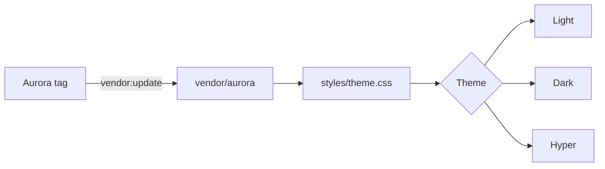

import { Badge, Card, CardGrid, FileTree, LinkButton, LinkCard, Steps, TabItem, Tabs } from '@astrojs/starlight/components';
import StatusBadge from 'starlight-aurora/components/StatusBadge.astro';

Use the theme select at the top right to see this page in Light, Dark, Hyper and Auto.

## Text

Body text with a [link](#text), **strong text**, *emphasis*, `inline code` and
<kbd>Ctrl</kbd> + <kbd>K</kbd>.

> A block quote. It can hold more than one line of text.

- A list item
- A second list item
  - A nested item

1. A numbered item
2. A second numbered item

## Asides

:::note
A note.
:::

:::tip
A tip.
:::

:::caution
A caution.
:::

:::danger
A danger.
:::

## Status badges

<StatusBadge status="running" /> <StatusBadge status="completed" /> <StatusBadge status="failed" /> <StatusBadge status="scheduled" /> <StatusBadge status="pending" /> <StatusBadge status="cancelled" /> <StatusBadge status="skipped" />

## Starlight badges

<Badge text="default" /> <Badge text="note" variant="note" /> <Badge text="tip" variant="tip" /> <Badge text="success" variant="success" /> <Badge text="caution" variant="caution" /> <Badge text="danger" variant="danger" />

## Code

```rust title="src/main.rs" {2}
fn main() {
    println!("Hello, Aurora");
}
```

```sh
npm install github:colliery-io/starlight-aurora#v0.1.0
```

```diff lang="js"
- plugins: [],
+ plugins: [starlightAurora({ hyper: true })],
```

## Table

| Theme | Base | Opt in |
|---|---|---|
| Light | light | no |
| Dark | dark | no |
| Hyper | dark | `hyper: true` |
| Auto | the operating system | no |

## Tabs

<Tabs>
  <TabItem label="npm" icon="seti:npm">`npm install`</TabItem>
  <TabItem label="angreal">`angreal docs build`</TabItem>
</Tabs>

## Cards

<CardGrid>
  <Card title="A card" icon="star">The text of a card.</Card>
  <Card title="A second card" icon="rocket">The text of a card.</Card>
</CardGrid>

<LinkCard title="A link card" description="It goes to the token map." href="../token-map/" />

<LinkButton href="../options/" icon="right-arrow">A link button</LinkButton>

## Steps

<Steps>

1. The first step.

2. The second step.

3. The last step.

</Steps>

## File tree

<FileTree>
- docs/
  - astro.config.mjs
  - src/
    - content/
      - docs/
        - index.mdx
- .github/workflows/docs.yml
- .angreal/task_docs.py
</FileTree>

## Diagram


