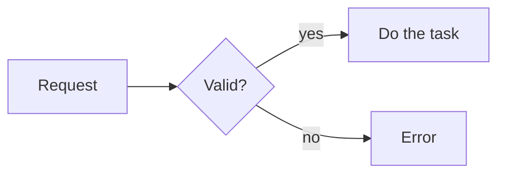

A how-to guide does one task for a reader who knows the project. Give the
steps. Do not teach.

## Procedure

1. CHANGE — do this.
2. CHANGE — then do this.

## Diagram

Write a Mermaid diagram in a `mermaid` code block:

